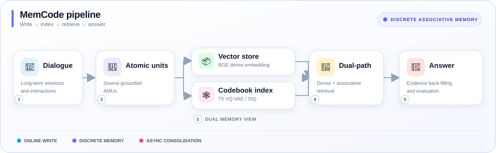

<h1 align="center">🧠 MemCode</h1>

<p align="center">
  <strong>Discrete Semantic Representations for Long-Term Agent Memory</strong><br/>
  <sub>NeurIPS 2026 Poster · Sydney</sub>
</p>

<p align="center">
  <a href="https://neurips.cc/virtual/2026/poster/152904"></a>
  <a href="https://arxiv.org/abs/2610.19472"></a>
  <a href="LICENSE"></a>
  <br/>
  
  
  
</p>

<p align="center">
  <a href="https://neurips.cc/virtual/2026/poster/152904">🏛️ <strong>NeurIPS Poster</strong></a> ·
  <a href="https://arxiv.org/abs/2610.19472">📄 <strong>arXiv</strong></a> ·
  <a href="https://arxiv.org/pdf/2610.19472">📕 <strong>PDF</strong></a> ·
  <a href="README_zh.md">🇨🇳 <strong>中文说明</strong></a> ·
  <a href="#-quick-start">🚀 <strong>Quick Start</strong></a>
</p>

> **MemCode** couples retrieval-oriented writing with discrete associative retrieval. It rewrites dialogue into source-grounded atomic memory units (AMUs), quantizes them with a T5 VQ-VAE, and retrieves evidence through both dense vectors and codebook co-occurrence.

## ✨ Highlights

| | Capability | What it brings to long-term agent memory |
| :---: | --- | --- |
| 🧩 | **Atomic Memory Units** | Rewrites context-dependent dialogue into self-contained, source-linked facts. |
| 🔢 | **Isomorphic Semantic Quantization** | Maps AMUs into a learnable codebook for stable, discrete memory representations. |
| 🕸️ | **Codebook Co-occurrence Retrieval** | Adds an associative retrieval path for evidence that is logically related but lexically distant. |
| 🧠 | **Dual-Path Recall** | Combines dense-vector similarity with codebook topology to recover richer evidence. |
| 🔄 | **Online Writes + Async Consolidation** | Keeps atomic writes lightweight while consolidating long-term memory in the background. |

## 🏗️ How It Works

<p align="center">
  
</p>

Dialogue is rewritten into source-grounded AMUs, indexed through dense embeddings and a discrete codebook, then retrieved through both paths before answer generation.

## 🚀 Quick Start

Use Python 3.10 or 3.11 and run commands from the repository root:

```bash
python -m pip install -r requirements.txt
python -m nltk.downloader punkt punkt_tab
```

1. 📚 Prepare the JSON files described in [`data/README.md`](data/README.md).
2. 🧠 Configure local model assets as described in [`models/README.md`](models/README.md).
3. 🔐 Copy `local_config.example.py` to `local_config.py`. Set `API_KEY`, `API_BASE_URL`, model paths and `DEVICE`. The endpoint must serve the selected working model and `JUDGE_MODEL`. Private configuration is excluded from Git.
4. 🧪 Set `MAX_ROWS = 1` for an initial run, or `None` for all rows. Use a new `RUN_LABEL` for each independent run.
5. ✅ Run `python check_environment.py`, then choose an entry below.

Parameters are explicit variables in `settings.py` and `local_config.py`; experiment selection does not require command-line options.

## 🧪 Run Configurations

| 📚 Dataset | 🤖 Working model | 🧱 Without consolidation | 🔄 With consolidation |
|---|---|---|---|
| LoCoMo | GPT | `run_locomo_gpt_baseline.py` | `run_locomo_gpt_consolidated.py` |
| LoCoMo | Qwen | `run_locomo_qwen_baseline.py` | `run_locomo_qwen_consolidated.py` |
| LongMemEval | GPT | `run_longmemeval_gpt_baseline.py` | `run_longmemeval_gpt_consolidated.py` |
| LongMemEval | Qwen | `run_longmemeval_qwen_baseline.py` | `run_longmemeval_qwen_consolidated.py` |

For example:

```bash
python run_locomo_gpt_baseline.py
```

`baseline` selects MemCode without consolidation. Memory construction, consolidation and answer generation use the selected working model. Configure the evaluator model through `JUDGE_MODEL`.

Outputs are stored in `runs/<profile>/<RUN_LABEL>/`, including QA traces, aggregate results, performance counters and memory stores. A run manifest records the configuration and dataset/checkpoint hashes. LoCoMo requires a fresh output directory; LongMemEval can resume a matching configuration. LoCoMo category 5 is excluded by the runner configuration.

## ♻️ Existing-Memory Workflow

Set `EXISTING_MEMORY_SOURCE_DIR` and `EXISTING_MEMORY_PROFILE`, then run:

```bash
python run_longmemeval_from_existing_memory.py
```

Each source `row_<index>_data/` must contain `metadata.db`, `metadata.db.stats.json`, `vector_stores/atomic_memory.faiss` and `vector_stores/atomic_memory_map.json`. Use the same dataset ordering, embedding model, checkpoint and working model. The workflow copies each store to a separate output directory before consolidation.

## 🔍 Optional Retrieval Variants

For a baseline profile, set `RETRIEVER_OVERRIDE` to a supported module:

- `src.retrieval.bm25_baseline_retriever`
- `src.retrieval.ablation_vector_top40_retriever`
- `src.retrieval.ablation_codebook_expansion_retriever` or `_v2` / `_v3`
- `src.retrieval.idf_retriever`
- `src.retrieval.codebook_expansion_retriever`

## 🏋️ Training & Tests

Prepare local DailyDialog JSON as described in [`data/README.md`](data/README.md), then train:

```bash
python -m pip install -r requirements-analysis.txt
python -m vqvae_training.train_vqvae
```

Checkpoints are saved under `models/T5/`. Training and inference share `src.utils.vqvae_t5_v10.VQVAE_T5`.

Run the offline checks:

```bash
python -m unittest discover -s tests -v
python tools/validate_release.py
```

## 📂 Repository Layout

| Path | Purpose |
|---|---|
| `settings.py` | Shared configuration and named profiles |
| `local_config.example.py` | Private configuration template |
| `run_*.py` | Experiment entry points |
| `experiments/` | Evaluation loops and existing-memory workflow |
| `src/core/` | Memory structures, SQLite metadata and FAISS vectors |
| `src/processing/` | Asynchronous extraction and consolidation |
| `src/retrieval/` | Retrieval implementations |
| `src/utils/` | Embedding, LLM, evaluator and VQ-VAE implementations |
| `vqvae_training/` | Training and codebook visualization helpers |
| `data/` | Data preparation instructions and downloader |
| `models/` | Local model configuration instructions |
| `tests/` | Offline tests |
| `tools/` | Source checking and packaging |
| `assets/` | README banner and visual assets |
| `.github/` | CI workflow |

## 📚 Citation

Official page: [NeurIPS 2026 Poster #152904](https://neurips.cc/virtual/2026/poster/152904)

If you find MemCode useful, please cite our NeurIPS 2026 paper:

```bibtex
@inproceedings{li2026memcode,
  title         = {MemCode: Discrete Semantic Representations for Long-Term Agent Memory},
  author        = {Li, Xin and Hu, Liang and Miao, Duoqian and Peng, Ming and Zhang, Qi},
  booktitle     = {Advances in Neural Information Processing Systems},
  year          = {2026},
  note          = {Poster},
  url           = {https://neurips.cc/virtual/2026/poster/152904},
  eprint        = {2610.19472},
  archivePrefix = {arXiv},
  primaryClass  = {cs.AI}
}
```

<p align="center">
  <sub>Built for long-term agent memory research · NeurIPS 2026 Poster · Sydney</sub>
</p>
